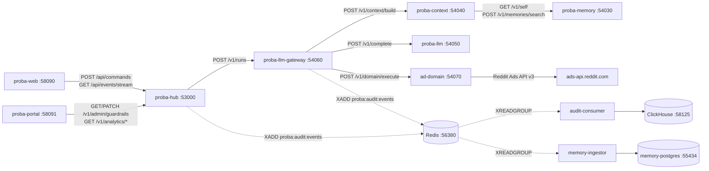
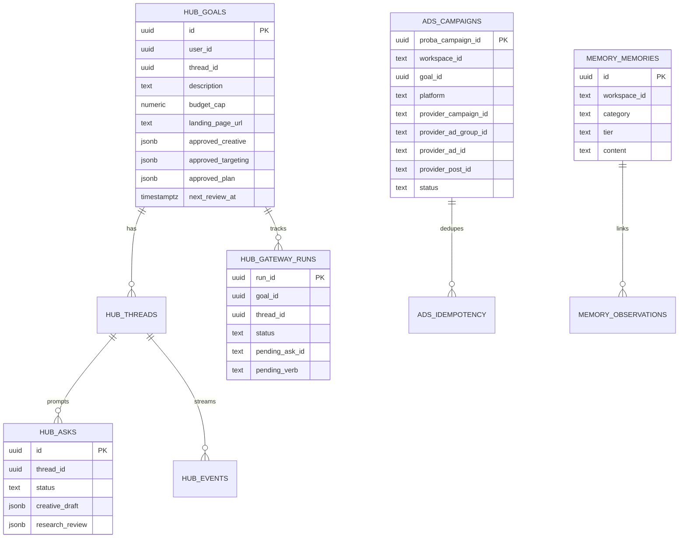

# Proba Local Debugging & Operations Guide

End-to-end engineering reference for running, inspecting, and debugging the 14-service Proba stack locally using the hybrid debug runner (`local/debug/debug.mjs` + `local/debug/monitor.sh`) and Docker infrastructure.

---

## 1. Architecture & Request Flow



---

## 2. Database Topology & Key Tables



| Postgres Container | Host Port | Database | Credentials | Primary Tables |
|---|---|---|---|---|
| `proba-local-postgres` | `55433` | `proba_hub` | `proba` / `proba_local_dev` | `users`, `goals`, `threads`, `messages`, `events`, `ui_payloads`, `asks`, `gateway_runs`, `campaign_reviews` |
| `proba-local-memory-postgres` | `55434` | `proba_memory` | `proba` / `proba_local_dev` | `memories` (`__proba_self__` system workspace + tenant workspaces), `observations`, `memory_jobs`, `audit_outbox` |
| `proba-local-context-postgres` | `55435` | `proba_context` | `proba` / `proba_local_dev` | `context_packets`, `jti_replay_log` |
| `proba-local-ads-postgres` | `55437` | `proba_ads` | `proba` / `proba_local_dev` | `campaigns`, `idempotency_records`, `metrics_snapshots` |
| `proba-local-redis` | `56380` | `0` | none | Stream `proba:audit:events`, rate-limit keys |
| `proba-local-clickhouse` | `58125` | `proba_audit` | `proba` / `proba_local_dev` | `audit_events`, `analytics_campaign_daily`, `analytics_llm_cost_hourly` |

---

## 3. Native Debug Stack vs Docker Commands

### Start / Stop / Restart Native Services (`local/debug/debug.mjs`)
All 14 application services run natively on the host with Node `--inspect` while Postgres, Redis, and ClickHouse run in Docker:

```bash
cd /Users/sangamdubey/Projects/proba/proba/local/debug

# Start all 14 native services (stops matching Docker app containers first)
node debug.mjs up

# Restart a single service after rebuilding its repo
node debug.mjs down gateway && node debug.mjs up gateway
node debug.mjs down hub && node debug.mjs up hub
node debug.mjs down web && node debug.mjs up web
node debug.mjs down memory-api && node debug.mjs up memory-api

# Check status and PIDs / ports / inspect ports
node debug.mjs status

# Stop all native debug processes
node debug.mjs down
```

### Live Colour-Coded Monitor (`local/debug/monitor.sh`)
```bash
cd /Users/sangamdubey/Projects/proba/proba/local/debug

# Tail live events from now
./monitor.sh

# Replay and tail since a specific UTC timestamp
./monitor.sh --since 2026-11-14T12:00:00Z
```

**Monitor Tags**:
- `RUN` / `LOOP` / `DONE`: Gateway run lifecycle and iteration counter (sourced from `local/debug/data/gateway/runs/*.json` and `hub.log`).
- `CTX` / `CTX401`: `POST /v1/context/build` latency or single-use `act-as` assertion replay refusal (`401`).
- `MODEL`: LLM turn token usage (`prompt`, `hit`, `miss`, `completion`) and USD cost estimate.
- `ASK` / `APPROVE`: Approval cards requested (`research.accept`, `creative.draft_post`, `ads.create_campaign`) and answered (`answer_ask`).
- `BLOCK`: Preflight or policy block (`preflight_blocked`, `completion_truncated`, `billing_not_ready`).
- `ADS` / `REDDIT`: `ad-domain` calls, metrics syncs, and Reddit v3 API responses/errors.

### Switch Back to Full Docker Stack
```bash
cd /Users/sangamdubey/Projects/proba/proba/local/debug
./back-to-docker.sh
```

---

## 4. Environment Variable Reference

Never commit or print `local/.env` or `local/keys/`. All configuration is injected via `local/.env` and overridden for native debug in `local/debug/debug.mjs`.

| Variable | Service(s) | Default | Allowed Values | What It Controls & When to Use |
|---|---|---|---|---|
| `BRAIN_MODE` | `hub` | `gateway` | `gateway`, `scenarios` | Uses `proba-llm-gateway` in real mode (`gateway`) or deterministic test scenarios (`scenarios`). |
| `BRAIN_MAX_OUTPUT_TOKENS` | `hub` | `4000` | `256`–`32768` | Per-turn output token budget requested by Hub on `POST /v1/runs`. Keep `>= 4000` so `creative.draft_post` tool-call JSON is never truncated. |
| `GATEWAY_MAX_COMPLETION_TOKENS` | `gateway` | `4000` | `256`–`32768` | Gateway hard cap on per-turn LLM completion tokens (tighten-only via guardrails). |
| `GATEWAY_MAX_ITERATIONS` | `gateway` | `6` | `1`–`16` | Max bounded LLM loop turns per `POST /v1/runs` request. |
| `GATEWAY_MAX_TOOL_CALLS` | `gateway` | `8` | `1`–`32` | Max tool calls executed in a single run. |
| `GATEWAY_MAX_RUN_COST_USD` | `gateway` | `0.50` | `> 0` | Max cumulative LLM USD cost per run before `BudgetExhaustedError`. |
| `GATEWAY_GUARDRAILS_FILE` | `gateway` | `local/debug/data/gateway/guardrails.json` | File path | Persisted tighten-only guardrails edited from Portal (`proba-portal`). |
| `GATEWAY_ADMIN_PUBLIC_KEYS_JSON` | `gateway` | Ed25519 keyset | JSON array | Verifies Hub-minted admin service tokens for `GET/PUT /v1/admin/guardrails`. |
| `RESEARCH_HTTP_FETCH` | `gateway` | `true` (local) | `true`, `false` | Enables `HttpUrlResearchProvider` to fetch the operator's public landing page, probe landing-page images, and fetch `lookupUrls`. |
| `RESEARCH_TIMEOUT_MS` | `gateway` | `8000` | `1000`–`30000` | Timeout for landing page HTML and image fetches. |
| `RESEARCH_MAX_BYTES` | `gateway` | `262144` | `4096`–`5000000` | Max HTML bytes read from a landing page or `lookupUrls` entry. |
| `ADS_MAX_DAILY_BUDGET` | `ads`, `gateway` | `5` | `> 0` | Hard daily budget cap (in `ADS_MAX_DAILY_BUDGET_CURRENCY`, default `USD`). Never exceed `5` in local testing. |
| `REDDIT_MODE` | `ads` | `live` | `live`, `sandbox`, `stub` | Controls Reddit connector mode. Use `live` with real credentials for end-to-end validation. |
| `ADS_METRICS_SYNC_INTERVAL_MS` | `ads` | `300000` | `>= 10000` | Background interval for pulling Reddit campaign metrics into `ad-domain` and emitting `campaign.metrics_synced`. |
| `CAMPAIGN_REVIEW_ENABLED` | `hub` | `true` | `true`, `false` | Enables Hub's periodic autonomous campaign reviewer (`review_performance` runs). |
| `MEMORY_SELF_SEED_ENABLED` | `memory-api` | `true` | `true`, `false` | Seeds `bootstrap/proba-self.json` into the reserved `__proba_self__` workspace on `memory-api` startup. |
| `PRICE_PROMPT_USD_PER_MILLION` | `llm` | `0.28` | `>= 0` | DeepSeek cache-miss input token rate (USD per 1M tokens). |
| `PRICE_PROMPT_CACHE_HIT_USD_PER_MILLION` | `llm` | `0.028` | `>= 0` | DeepSeek cache-hit input token rate (USD per 1M tokens). |
| `PRICE_COMPLETION_USD_PER_MILLION` | `llm` | `0.42` | `>= 0` | DeepSeek completion token rate (USD per 1M tokens). |

---

## 5. Failure Codes & Debugging Recipes

| Error / Code | Origin | Root Cause | How to Inspect & Fix |
|---|---|---|---|
| `preflight_blocked` (`ads.funding` / `billing_not_ready`) | `gateway` -> `ads` -> Reddit | Reddit ad account has `is_servable: false` or no valid funding instrument (`funding_instruments` empty). | Expected when wallet is unfunded. Thread shows `"This step is blocked"` with a **Retry** button. Fund the Reddit Ads wallet and click **Retry**. |
| `preflight_blocked` (`ads.blueprint`) | `gateway` | `ads.*` mutation attempted before required blueprint inputs exist. | Non-`ads.*` tools (`creative.draft_post`, `research.*`) use `read_or_plan` and do not require `ads.blueprint`. |
| `completion_truncated` | `gateway` | Model output hit `finishReason === 'length'` twice in a row. | Check `BRAIN_MAX_OUTPUT_TOKENS` on Hub and `GATEWAY_MAX_COMPLETION_TOKENS` on Gateway (both default to `4000`), plus `maxCompletionTokens` in Portal Guardrails. |
| `CTX401` (`POST /v1/context/build -> 401`) | `context-api` | Single-use `act-as` JWT (`jti`) was replayed or clock skew / key mismatch occurred. | Gateway builds context once per Hub request and reuses the packet across loops (`record.messages`). If `401` occurs on first call, verify `CONTEXT_ACT_AS_PUBLIC_KEYS_JSON`. |
| `creative_invalid` | `gateway` | `creative.draft_post` failed a hard check: length cap, banned phrase, uncited claim, foreign URL, wrong brand casing, or unverified `imageUrl`. | Inspect the tool result message in `local/debug/data/gateway/runs/<runId>.json` (`messages` array); the model receives the exact reason and self-corrects on the next loop turn. |
| `research_not_accepted` | `gateway` | `creative.draft_post` or `ads.create_campaign` called before operator accepted the `research.accept` card for the current landing URL. | Approve the Research Review card in the web thread first. |

### Useful Inspection One-Liners

```bash
# Inspect the latest gateway run JSON (state, toolTurns, llmTurns, preflight needs)
ls -t /Users/sangamdubey/Projects/proba/proba/local/debug/data/gateway/runs/*.json | head -n 1 | xargs jq '{runId, state, iteration, toolTurns: [.toolTurns[] | {verbName, state, code: .result.code}], error: .snapshot.error}'

# Inspect goals and approved creative/targeting/plan in Hub Postgres
PGPASSWORD=proba_local_dev psql -h 127.0.0.1 -p 55433 -U proba -d proba_hub \
  -c "SELECT id, landing_page_url, approved_creative, approved_targeting, approved_plan FROM goals ORDER BY created_at DESC LIMIT 5;"

# Inspect pending/answered asks and creative drafts in Hub Postgres
PGPASSWORD=proba_local_dev psql -h 127.0.0.1 -p 55433 -U proba -d proba_hub \
  -c "SELECT id, status, creative_draft->>'headline' AS headline, creative_draft->>'imageUrl' AS image_url FROM asks ORDER BY created_at DESC LIMIT 5;"

# Check active self-memory version served by memory-api
curl -s http://127.0.0.1:54030/health
```
